# Agentic AI – Banking Customer Service: Architecture

The design is built one step at a time. Each step adds a single box or boundary. Names below match the architecture diagrams. The learning build uses the free stack in [DECISIONS.md](DECISIONS.md). [COURSE.md](COURSE.md) teaches each step as a textbook chapter.

Business problem this system is for: about 4.2 lakh calls a month, 65% of them three questions (balance, a debit on the account, cheque book). Netbanking can already do these, but it takes fourteen screens, so customers call. Average handling time is four minutes.

**Build status**

| Status | Steps |
|---|---|
| Completed | 1 |
| In progress | None. Step 1 already runs in Docker. Pulling `qwen2.5:7b` into the Compose volume is a setup task, not a new step. |
| Yet to start | 2, 3, 4, 5, 6, 7, 8, 9, 10, 11, 12, 13, 14 |

---

## Step 1: A Simple Demo

**Status: Completed.** The page, API, agent, and Ollama call work. They now run as the `api` and `ollama` containers. The chat UI is still `app/static/index.html`. React is decided and not built.

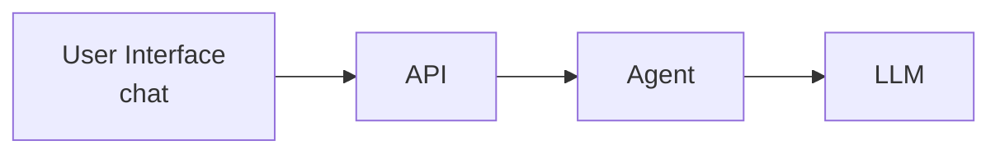

Three boxes, plus the API in front of the agent:

- **User Interface (chat)** is what the customer types into.
- **API** is the only door into the system. The UI never talks to the agent or the LLM directly.
- **Agent** decides what to say.
- **LLM** generates the language.

This can chat. It cannot see an account, it does not know who is talking, and it forgets the conversation when the process restarts.

---

## Step 2: Bank APIs as tools

**Status: Yet to start.**

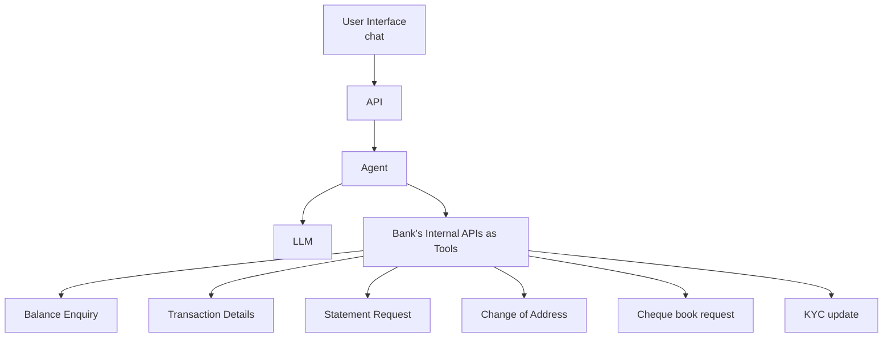

The agent can now call the bank's existing internal APIs as tools:

| Tool | What it answers |
|---|---|
| Balance Enquiry | "What's my balance?" |
| Transaction Details | "What was this debit?" |
| Statement Request | "Send me a statement." |
| Change of Address | Update the registered address |
| Cheque book request | "Send me a cheque book." |
| KYC update | Update KYC details |

One agent holds every tool, including writes (address, cheque book, KYC). A mistake or a bad prompt can reach any of them.

---

## Step 3: Domain sub-agents, each with only its tools

**Status: Yet to start.**

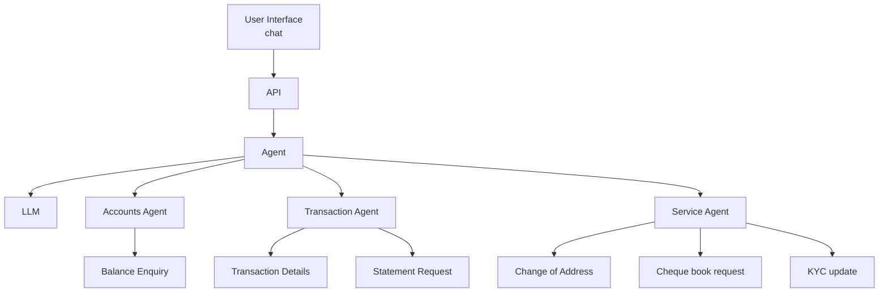

The single agent is split by domain. A sub-agent is given only the tools for its domain:

| Sub-agent | Tools |
|---|---|
| Accounts Agent | Balance Enquiry |
| Transaction Agent | Transaction Details, Statement Request |
| Service Agent | Change of Address, Cheque book request, KYC update |

The Transaction Agent cannot change an address or order a cheque book, because those tools are not on it. The parent Agent still owns the LLM call.

---

## Step 4: Coordinator Agent

**Status: Yet to start.**

A question like *"Get me my balance along with the last 5 transactions"* needs the Accounts Agent and the Transaction Agent in the same turn. Something has to decide who answers, call both, and merge the replies.

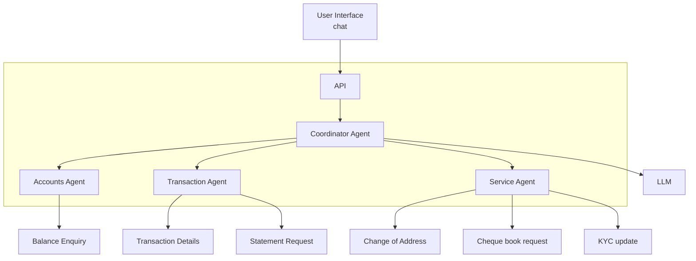

The **Coordinator Agent** replaces the single parent agent:

- It reads the question, picks one or more sub-agents, and combines their results into one reply.
- It holds no banking tools itself.
- Sub-agents stay limited to the tools from Step 3.
- The LLM sits beside the coordinator and is shared by this group.

---

## Step 5: MCP servers (loosely coupled tools)

**Status: Yet to start.**

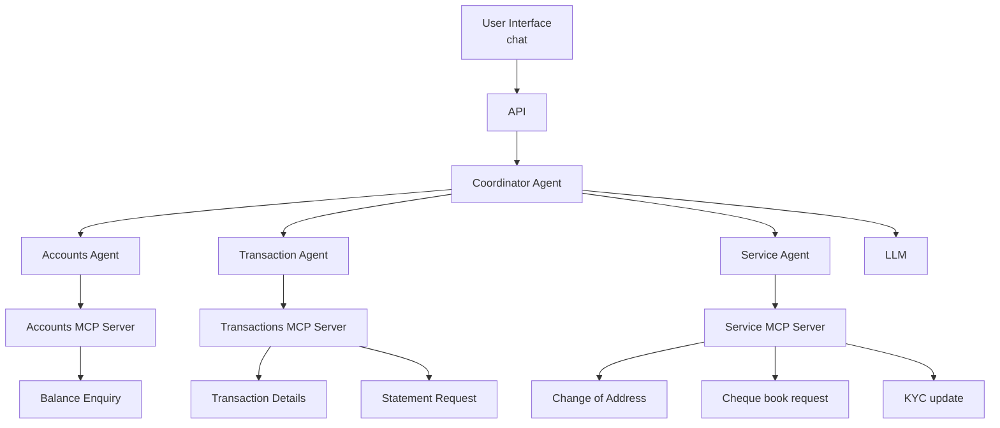

Each sub-agent stops calling bank APIs directly. It calls its own **MCP server**, and the MCP server exposes the tools:

| MCP server | Tools behind it |
|---|---|
| Accounts MCP Server | Balance Enquiry |
| Transactions MCP Server | Transaction Details, Statement Request |
| Service MCP Server | Change of Address, Cheque book request, KYC update |

Agents and bank APIs can now change on their own. A new tool is added on the MCP server. The agent only sees the tool schema. Any agent framework that speaks MCP can reuse these servers.

---

## Step 6: Authentication

**Status: Yet to start.**

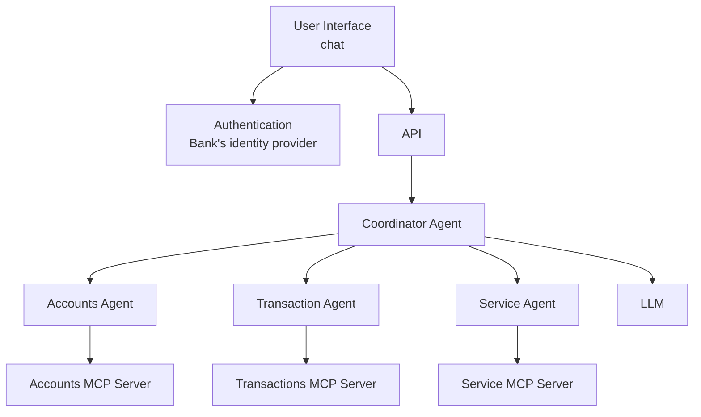

**Authentication answers "who is this?"**

The chat UI authenticates with the **bank's existing identity provider** before the API will accept a conversation. The API then knows the customer id from a verified login, not from anything the customer typed to the bot.

---

## Step 7: Authorisation

**Status: Yet to start.**

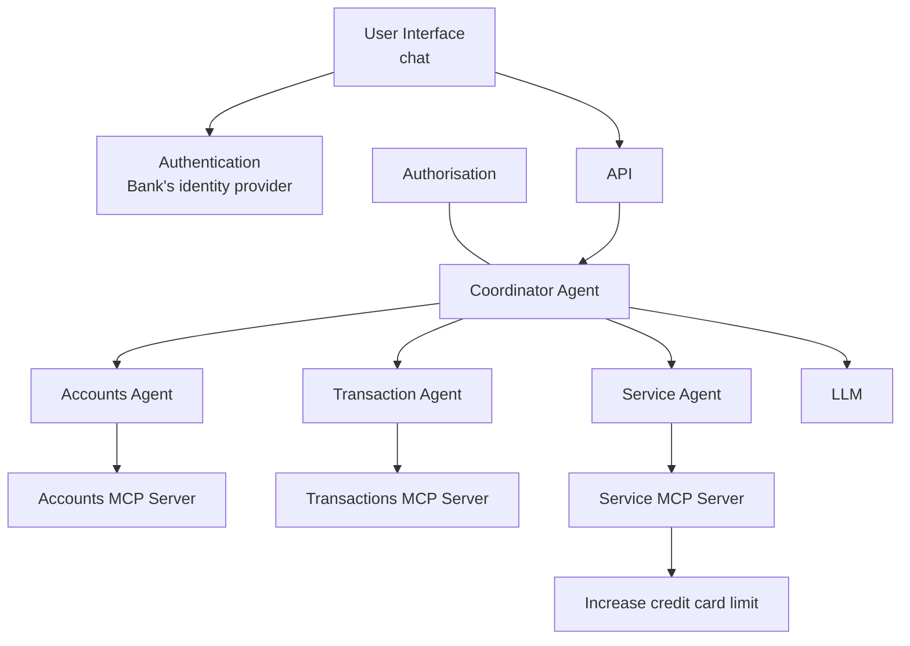

**Authorisation answers "what is this person allowed to do?"** It is a separate box from authentication, and it sits on the coordinator boundary.

Being logged in is not enough. The authorisation check decides which agent and which tool this customer may use. The diagram adds **Increase credit card limit** on the service side here: it is a higher-risk tool than a balance enquiry, so it needs its own permission even for an authenticated customer.

Authentication and authorisation stay separate because a real, logged-in customer can still ask for an account or an action that is not theirs.

---

## Step 8: Session management

**Status: Yet to start.**

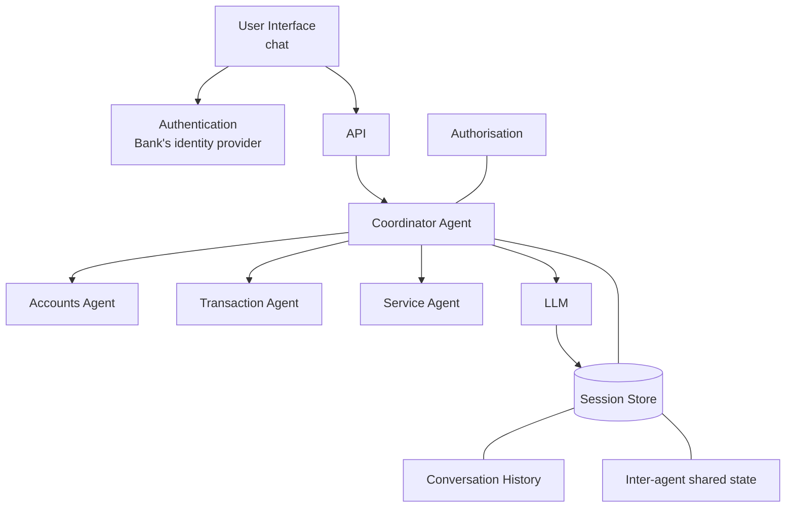

The **Session Store** is shared by the LLM path and the agents. It holds two different things:

- **Conversation history** so a follow-up ("and the one before that?") still makes sense.
- **Inter-agent shared state** so the Accounts Agent and the Transaction Agent can work on the same turn. Example: the customer said "my savings account"; both agents read that fact instead of asking again.

The coordinator writes shared facts. A sub-agent reads only the slice it needs.

---

## Step 9: The session that stored the card number

**Status: Yet to start.**

Step 8 made the bot remember. It also made a second copy of customer data. There is no diagram for this step. It is the gap between the session store and the rule that a card number must not leave the bank.

A customer asks about a debit and pastes the full card number so the agent can find the right transaction. The coordinator writes that turn into **conversation history**. On the next message the whole history goes back to the LLM. The card number is now in the session store, and it is sent again on every later turn.

Inter-agent shared state has the same problem. If the Transaction Agent writes the raw narration into the shared store, the Service Agent can read it on a later turn even though it has no transaction tools.

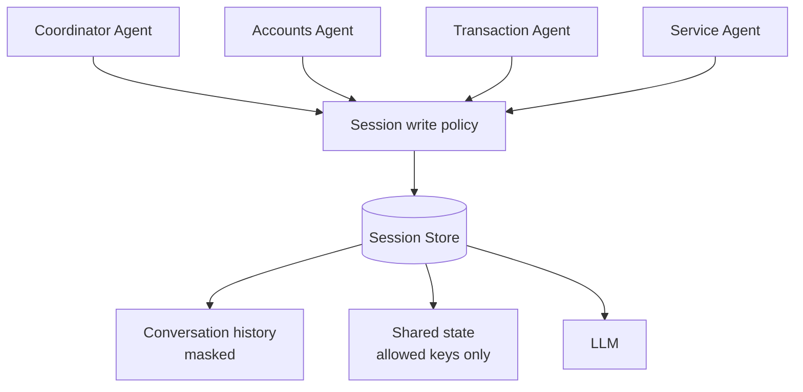

What the write policy allows:

| Stored | Not stored |
|---|---|
| Opaque account ref (`acc_1`) | Full card number, CVV, OTP |
| Which account the customer picked | Full account number |
| Last few masked transactions the customer was shown | Raw tool payloads |
| Pending action, such as "cheque book not yet confirmed" | Another agent's full result |

Rules:

- Mask before write. A card number that arrives in a user message or a tool result is replaced before it lands in the session.
- Shared state is a fixed set of keys. A sub-agent reads its own view, not the whole store.
- The session is encrypted, and it expires on the idle and absolute timeouts from the login session.
- The LLM still sees balances, names, and masked history, because it needs them to answer. Keeping the card number out of the store does not decide which model is allowed to see the rest. That is Step 10.

---

## Step 10: The card number that shouldn't leave the bank

**Status: Yet to start.**

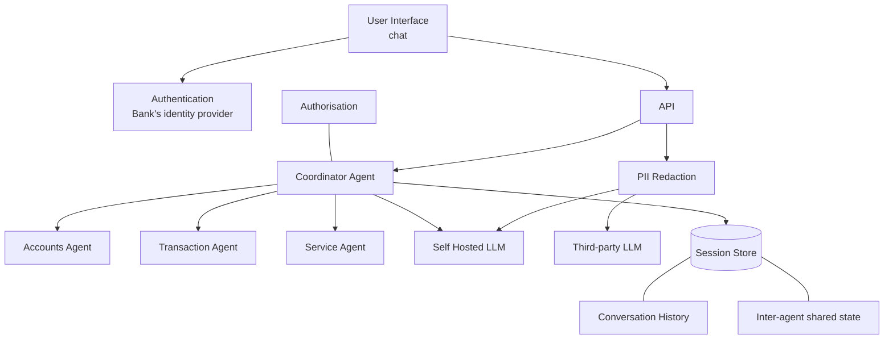

The single LLM box splits in two:

- **Self Hosted LLM** runs inside the bank. Anything with a card number, account number, balance, or name goes here.
- **Third-party LLM** is outside the bank. It is only reached after **PII Redaction**, which strips or replaces those values.

PII redaction sits on the path out of the API toward the models. A card number in a question or in tool output is removed before a third-party model can see it.

---

## Step 11: Agent Evaluation Suite

**Status: Yet to start.**

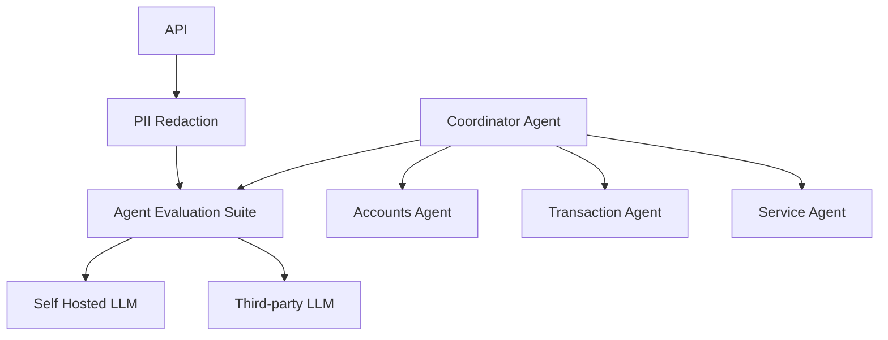

The **Agent Evaluation Suite** sits on the path between the agents and the LLMs (after PII redaction).

It checks a change to a prompt, a model, or a tool before that change serves customers. Typical checks:

- The coordinator picked the right sub-agent, including the two-agent case from Step 4.
- The sub-agent called the right tool with the right arguments.
- Amounts and dates in the reply match the tool result.
- A red-team set (prompt injection, asking for another customer's account) still fails closed.

A drop past the threshold blocks the release.

---

## Step 12: Where did my system go wrong?

**Status: Yet to start.**

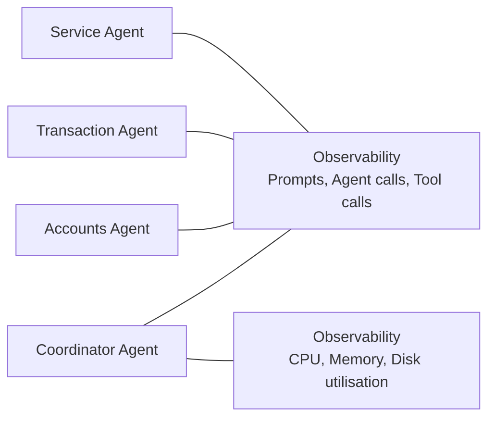

**Observability** is two boxes, both attached to the agent group:

| Box | What it records |
|---|---|
| Prompts, agent calls, tool calls | Which agent ran, which prompt version, which MCP tool, what the model returned |
| CPU, memory, disk utilisation | Whether the process itself is unhealthy |

When a customer gets a wrong balance or a stuck turn, the first box shows the agent path. The second shows whether the host was out of memory or disk while it happened.

---

## Step 13: A bill that tripled

**Status: Yet to start.**

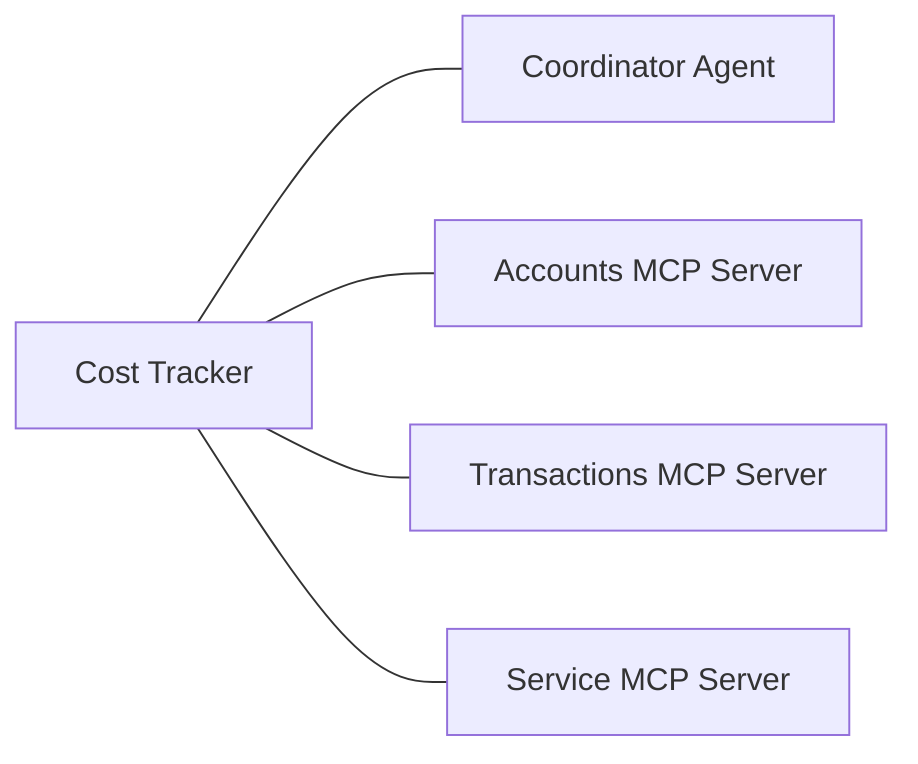

The **Cost Tracker** watches the coordinator and the three MCP servers.

A bill triples when an agent loops: the same tool is called again and again, or the coordinator keeps delegating without finishing. The tracker attributes tokens and tool calls per conversation, per agent, and per MCP server, and it enforces a cap (max steps, max tool calls, max tokens) so a loop stops instead of running until the invoice does.

---

## Step 14: Edge layer security

**Status: Yet to start.** Docker Compose on this Mac is only how Step 1 runs. It is not this edge layer.

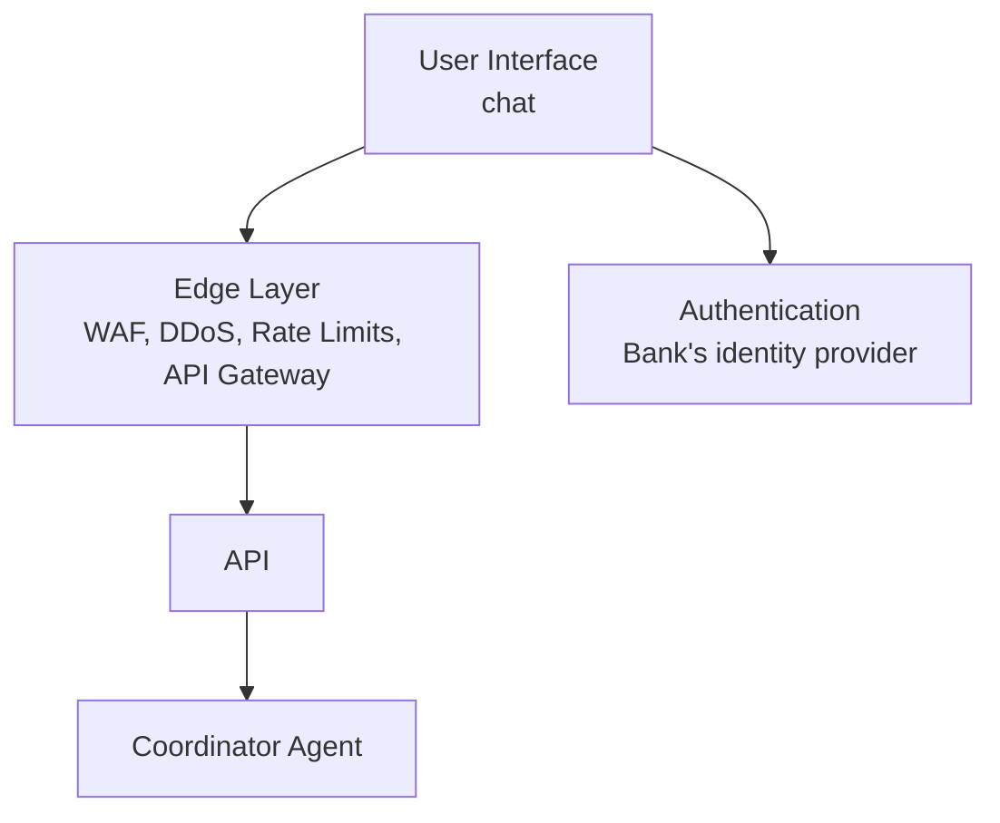

The **Edge Layer** stands between the chat UI and the API:

- **WAF** filters obvious malicious requests before they reach the agent.
- **DDoS protection** absorbs traffic that would otherwise drown the API.
- **Rate limits** cap how often one customer or one client can call.
- **API Gateway** is the managed front door: TLS, routing, and request size limits.

Authentication still happens with the bank's identity provider. The edge layer does not replace it. It keeps untrusted internet traffic from hitting the coordinator directly.

---

## How the steps stack

Steps 1–8 and 10–14 follow the diagrams. Step 9 is the missing number: it is filled in here, not taken from a diagram.

| Step | Status | What was added | Why |
|---|---|---|---|
| 1 | Completed | UI → API → Agent → LLM | A chat demo, now started with Docker Compose |
| 2 | Yet to start | Bank internal APIs as tools on one agent | The bot can answer with real account data |
| 3 | Yet to start | Accounts, Transaction, and Service agents | Each agent only gets its own tools |
| 4 | Yet to start | Coordinator Agent | One question can need more than one agent |
| 5 | Yet to start | Accounts, Transactions, and Service MCP servers | Agents and bank APIs change independently |
| 6 | Yet to start | Bank identity provider | Know who is talking |
| 7 | Yet to start | Authorisation | Know what that person may do |
| 8 | Yet to start | Session store | Conversation history and inter-agent shared state |
| 9 | Yet to start | Session write policy | The store must not keep a raw card number and replay it |
| 10 | Yet to start | PII redaction, self-hosted LLM, third-party LLM | A card number does not leave the bank |
| 11 | Yet to start | Agent Evaluation Suite | Catch a bad prompt or model before release |
| 12 | Yet to start | Observability | Trace agent behaviour and host health |
| 13 | Yet to start | Cost Tracker | Stop a loop from tripling the bill |
| 14 | Yet to start | Edge layer | WAF, DDoS, rate limits, API gateway in front of the API |
